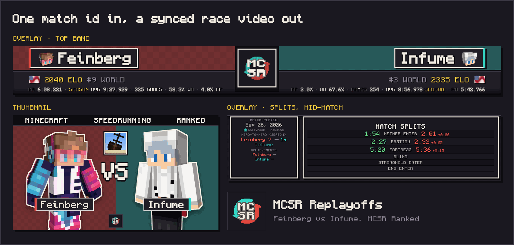
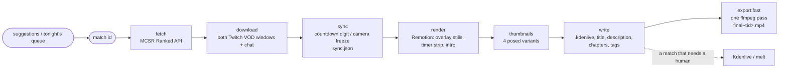
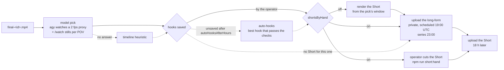

# mcsr-vid

[](https://github.com/Tymonoman/mcsr-vid/actions/workflows/ci.yml)



Turns an [MCSR Ranked](https://mcsrranked.com) match id into a finished race video for the
YouTube channel [MCSR Replayoffs](https://www.youtube.com/@MCSRReplayoffs)
([subscribe](https://www.youtube.com/channel/UCm2mAyONTHlmIxZzNmi388w?sub_confirmation=1)).
It pulls the match, the players and their head-to-head from the MCSR Ranked API, downloads
both players' Twitch VODs, lines the two POVs up on the pre-match countdown, and puts a
split-timer overlay over them. Each match produces:

- `final-<id>.mp4`: both POVs side by side at 60 fps, the overlay, an intro card and the
  subscribe card at the end. 1080p by default, 1440p with `exportUpscale1440` (on at the lab).
  The intro is `introSec` long (2 to 7 s, default 7; 3 at the lab). For a match that needs a
  human there is `match-<id>.kdenlive` as well.
- four thumbnail variants, the title, description, chapters and tags
- a vertical Short of the match's best moment
- for a playoff series, every game joined into one video (`series-<g1>.mp4`)

Most days nobody presses a button. At 03:00 UTC the nightly renders up to `nightlyMaxRenders`
matches (default 1; 2 at the lab) and a model picks each one's Short moment. The hooks are saved
by the operator, or automatically `autoHooksAfterHours` after the pick (default off; 6 h at the
lab). The long-form then uploads private, scheduled for 19:00 UTC (23:00 for a series), and the
Short follows 18 h later. A Studio worker pins the comment, adds the end screen and runs
thumbnail tests, and a Telegram bot sends the operator a report every morning.

## The pipeline



`npm run generate-project` runs every stage up to `write`, and `npm run export:fast` produces
the MP4 (it renders first when it has to). Each stage reuses what is already in
`<mediaDir>/<id>/`. The match footage is never cut. When the detector cannot read a clip's
countdown, the dashboard's "Fix the sync by hand" fold settles it, and the fix needs a
re-export rather than a re-render. The nightly takes the first eligible suggestion: a known
player unless the operator queued it, never a runner on the block list.

## The Short and publishing



1. **Model pick** (`src/shorts/videoPick.ts`). Antigravity's `agy` (`reasonerCommand`) watches
   the whole match and returns one continuous window of 12 to 60 s, which side to focus on, a
   hook suggestion, up to three title hooks and a one-line reason. If it gives no answer, the
   timeline heuristic (`src/shorts/shortMoment.ts`) picks instead and
   `short-<id>.pick-error.json` records why. `npm run pick -- <id> --force` asks again.
2. **Hooks.** Nothing renders or uploads until the hooks are saved. The title hook becomes the
   long-form's title and the Short hook goes into `short-<id>.hook.txt`. The operator saves them
   on the dashboard; with `autoHooksAfterHours` set, a match still unsaved that long after its
   pick gets the best hook that passes the spoiler and label checks, and the chain runs as if
   Save had been pressed. If no hook passes, nothing is saved and the match lands in the
   morning report's "Needs you".
3. **The Short** (`src/dashboard/shortFlow.ts`). With `shortsByHand` off, the chain renders the
   Short from the pick's window. With it on (the lab), the operator cuts the Short by hand and
   registers it with `npm run short:hand`, which checks the format, the hook and the block list.
   The pick still runs, as a hint for where the moment is.
4. **Upload.** The long-form uploads at its slot and the Short 18 h later, only while
   `youtubeUploadEnabled` and `nightlyUpload` allow it. After the upload the hooks lock.
   `short-<id>.status.json` records each step. With `youtubeAutoFinish` the finish steps
   (playlists, the channel's comment, tags) run on their own.

## What runs on its own

- **The nightly** (`src/dashboard/nightly.ts`): renders, exports, queues the pick. Two renders a
  night at the lab.
- **Auto-hooks** (`autoHooksAfterHours`): saves hooks the operator left unsaved.
- **The Studio worker** (`src/youtube/studioWorker.ts`, `npm run studio -- worker`): a real
  Chrome signed in by hand to the channel's Studio (an Editor account is recommended, see CLAUDE.md). Every ~20 minutes, outside the
  nightly's hours, it pins the channel's own comment, adds an end screen, links each Short to its
  long-form, and starts and reads Test & Compare runs. It never changes anything set by
  hand and never signs in by itself. `scripts/studio-worker.sh` keeps it running.
- **The experiment engine** (`src/dashboard/experiments.ts`, `.experiments.json`): A/B tests
  between videos. It applies each day's render settings before the nightly and judges the arms
  on CTR and retention from the channel's own Analytics and Reporting data.
- **The Telegram bot** (`src/telegram/`): a morning report at 07:00 Warsaw (what needs the
  operator, overnight uploads, channel stats, unanswered comments) and read-only slash commands
  (`/needs`, `/ypp`, `/stats 7d`, `/ask`). Claude Haiku writes the headline and answers `/ask`
  from counts, titles, ids and the operator's notes, never comment text.

## Running it

Requirements: Node 24 (what the image and CI run), `ffmpeg`/`ffprobe` and
[`yt-dlp`](https://github.com/yt-dlp/yt-dlp) on `PATH`, and `python3` for `/watch` and
`npm run analytics`. You only need MLT (`melt-7`) to open or validate a Kdenlive project.
`Dockerfile` + `compose.yaml` define the lab's image: one container you exec into, and
`mcsr-dashboard`.

```sh
npm install
cp mcsr-vid.config.example.json mcsr-vid.config.json   # optional: any subset of keys
npm run dashboard                                      # http://localhost:8080
```

Commands accept a match id or a match page URL as the first argument, with flags after it
(the trailing number of whatever is given is taken as the match id, so pass an MCSR Ranked
match, not a Twitch link). Extra arguments go after `--`. The everyday
commands (`dashboard`, `export:fast`, `short`, `short:hand`, `pick`, `series`, `sync-status`,
`chat`, `clip`, `tg`, `studio`, `tc-thumbs` and the rest) are in the
[Commands table in CLAUDE.md](CLAUDE.md#commands). The ones not listed there:

| Script | What it does |
| --- | --- |
| `fetch-match -- <id>` | Print the match, both players and their head-to-head from the MCSR Ranked API as JSON. |
| `download-vods -- <id>` | Both POV windows and the chat. Twitch deletes most archives after 14 days, so run it early. |
| `validate-sync -- <id>` | Check or refine the alignment and render a preview clip. |
| `render-overlay -- <id>` / `generate-thumbnail -- <id>` | The overlay stills, timer strip and intro / the default-pose thumbnail. |
| `generate-project -- <id>` | Every stage up to the `.kdenlive` project and the text. |
| `batch -- <file>` | The full pipeline for each id listed in the file, one per line. |
| `status` / `score -- <id>` | Each match's stages / a split-by-split breakdown. |
| `remotion:studio` | Remotion Studio, for previewing the compositions. |
| `build-overlay-css` | Rebuild `remotion/overlay.css`. The render scripts run it themselves. |
| `youtube-auth` | One-time OAuth consent. Writes `youtube-token.json`. |
| `archive -- <id>` | Copy a finished match to the NAS with rsync, at once (no 03:00–08:00 window check, so run it in the window). Nothing is deleted. |
| `typecheck` / `format` | `tsc --noEmit` / prettier. |
| `test:unit` / `test` | Every `*.test.ts` except the four that drive Chromium and ffmpeg / all of them. |

## Credentials

| Part | Needs | Where |
| --- | --- | --- |
| Match data (MCSR Ranked API) | nothing, public (about 500 requests per 10 min) | |
| VODs (yt-dlp) and chat (Twitch web GQL) | nothing | |
| The follower signal in match suggestions | `TWITCH_CLIENT_ID`, `TWITCH_CLIENT_SECRET` (optional: without them it counts how often a player turns up streaming) | `.env` |
| The Short's model pick | `agy` installed and signed in (`reasonerCommand`). On the lab: its own HOME in `.tools/agy-home`, or `GEMINI_API_KEY`. Optional: without it the heuristic picks | `.tools/`, `.env` |
| `/watch` transcripts for the pick | `GROQ_API_KEY` (Groq Whisper) or `OPENAI_API_KEY`. Optional: stills only without one | `.env` |
| YouTube: upload, finish, pairing, analytics | an OAuth client (`YOUTUBE_CLIENT_SECRETS`, default `~/.claude/youtube_client_secrets.json`), then `npm run youtube-auth` to write `youtube-token.json` (`YOUTUBE_TOKEN_FILE`). Uploads also need `youtubeUploadEnabled` | repo root, config |
| The Telegram bot | `TELEGRAM_BOT_TOKEN`, `TELEGRAM_CHAT_ID` (no token: the bot does not start) | `.env` |
| The bot's Claude Haiku | a `claude` CLI login: `claude setup-token`, then `CLAUDE_CODE_OAUTH_TOKEN` | `.env` |
| The Studio worker | a Chrome profile signed in by hand to the channel's Studio (the `studio-profile` volume; an Editor account is recommended), and `studioAutomation` or `--enable` | volume, config |
| `npm run analytics` | the claude-youtube skill's own token and its Python packages | `~/.claude/` |
| Nightly notifications | `nightlyNotifyUrl` | config |
| Tests and CI | nothing | |

`.env`, `mcsr-vid.config.json`, `youtube-token.json` and `.tools/` are gitignored.
`scripts/preflight.sh` warns when a credential is missing or about to expire. What the channel
sends where is on the [privacy page](https://mcsr.sezamki.site/privacy.html).

## Tests and CI

The tests are plain assertion scripts with no framework, each next to the file it tests.
`npm run test:unit` runs all but four, and `npm test` adds those four (they drive Chromium and
ffmpeg). To run a single test: `npx tsx src/pipeline/kdenliveProject.test.ts`.
`bash scripts/browser-checks/run-all.sh <url>` drives a real dashboard in Playwright.
[CI](.github/workflows/ci.yml) runs `tsc --noEmit` and `npm run test:unit` on every push and
pull request, with no secrets.

## Layout

```
src/
  api/          MCSR Ranked and Twitch clients, the API types, avatar renders
  pipeline/     a match to a video: fetch, VODs, sync, overlay, project, export, the text
  thumbnails/   the variant strip, Test & Compare sets
  shorts/       the model pick, /watch, the heuristic, the vertical render, hand-made Shorts
  playoffs/     the bracket and its games; a series as one video
  youtube/      the Data API client and auth, uploads, the channel pairing, the publish slot,
                the Studio browser automation and its worker
  dashboard/    the server, its routes, the Short chain, jobs, the nightly, suggestions,
                auto-hooks, the experiment engine
  telegram/     the bot: morning report, slash commands, the Claude adapter
  clips/        standalone clips that are not a match (prototype; uploads nothing)
  cli/          batch, status, score, chat, bench, retention, the TUI
  fixtures/     saved API responses the tests read
remotion/       the overlay, intro, thumbnail, Short and clip compositions (React + Remotion)
public/         the dashboard's browser files, served from disk (no build step)
scripts/        browser checks, the overlay CSS build, preflight, the subreaper, the Studio
                worker's supervisor, the seed-type icons, the hand-made Short helper
handbook/       for the operator: the Studio fallback, the API review, the domain
branding/       the logo and banner and their generator
docs/           the GitHub Pages site for mcsr.sezamki.site (home, privacy, terms)
deploy/         the lab's systemd user unit
```

Start with the doc for your role:

- **[CLAUDE.md](CLAUDE.md)**: for agents and for anyone changing the code. It has the house
  rules (no spoilers, no runner nicknames, the footage is never cut, nothing irreversible without
  the operator), the commands, what each render produces, the dashboard's design and the known
  pitfalls. [handbook/claude-md-reference.md](handbook/claude-md-reference.md) has the reasons.
- **[handbook/](handbook/README.md)**: for the operator. It covers running the channel: the
  Studio fallback, the YouTube API compliance review and the domain.

## Licence

MIT; see [LICENSE](LICENSE).
