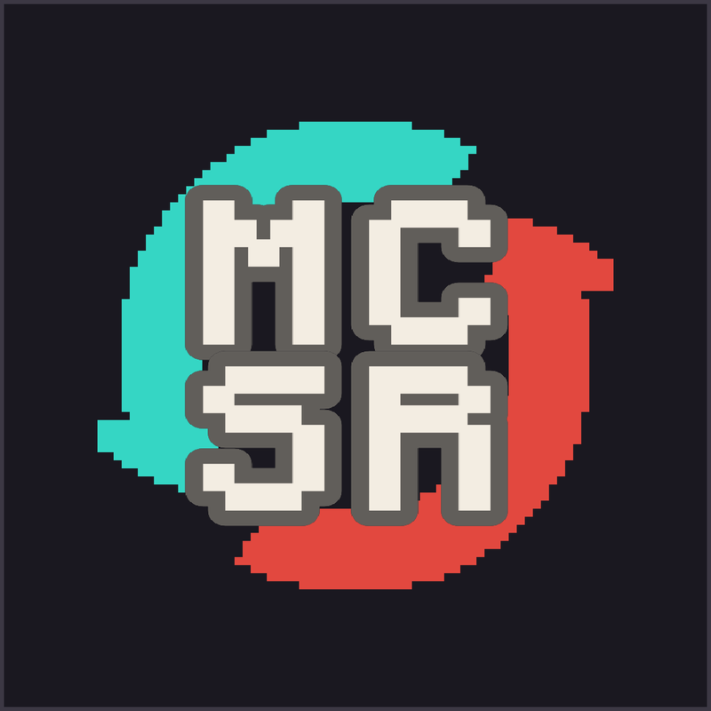
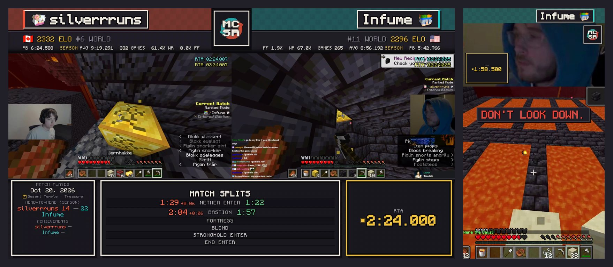
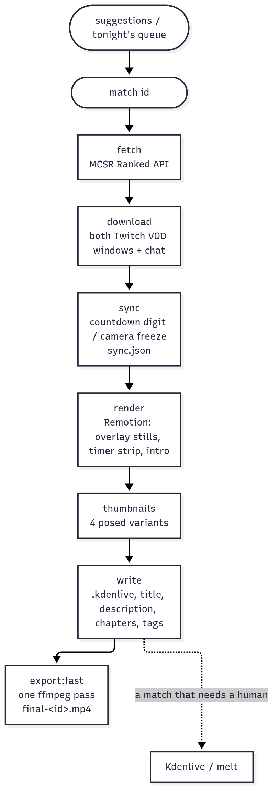
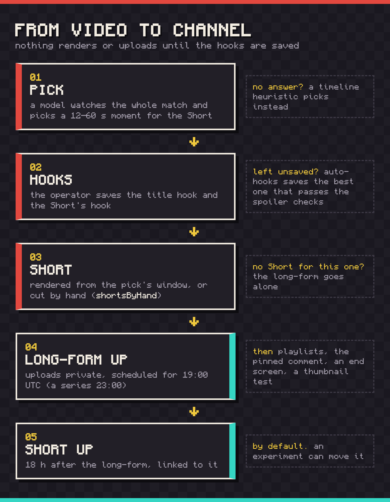
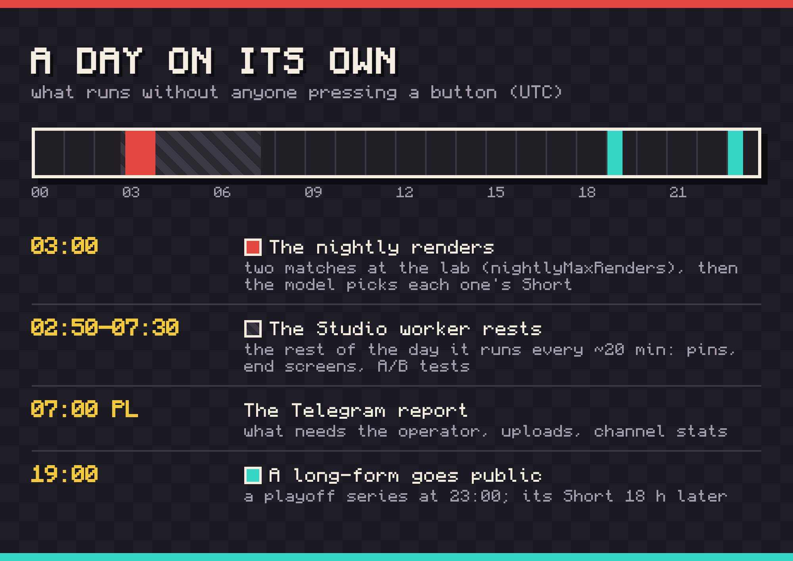

<p align="center">
  
</p>

<h1 align="center">mcsr-vid</h1>

<p align="center">
  An MCSR Ranked match id in, a finished race video out.<br>
  The pipeline behind the YouTube channel <a href="https://www.youtube.com/@MCSRReplayoffs">MCSR Replayoffs</a>.
</p>

<p align="center">
  <a href="https://github.com/Tymonoman/mcsr-vid/actions/workflows/ci.yml"></a>
  <a href="https://www.youtube.com/channel/UCm2mAyONTHlmIxZzNmi388w?sub_confirmation=1"></a>
  <a href="LICENSE"></a>
</p>


It pulls the match, both players and their head-to-head from the
[MCSR Ranked](https://mcsrranked.com) API, downloads both players' Twitch VODs, lines the two
POVs up on the pre-match countdown and lays a split-timer overlay over them.

## What one match becomes



| Output | What it is |
| --- | --- |
| `final-<id>.mp4` | Both POVs side by side at 60 fps with the overlay, an intro card and a subscribe card. 1080p, or 1440p with `exportUpscale1440`. |
| Thumbnails | Four posed variants. |
| Text | Title, description, chapters and tags. |
| A Short | A vertical cut of the match's best moment. |
| `series-<g1>.mp4` | A playoff series: every game joined into one video. |
| `match-<id>.kdenlive` | A Kdenlive project, for a match that needs a human. |

The match footage itself is never cut.

## How it works



`npm run generate-project` runs every step up to *write*; `npm run export:fast` encodes the MP4
from what is on disk and refuses if the render has not run. Each step reuses what is already in
`<mediaDir>/<id>/`. When the detector cannot read a clip's countdown, the dashboard's
"Fix the sync by hand" fold settles it; the fix needs a re-export, not a re-render.



A model (`agy`, `src/shorts/videoPick.ts`) picks the Short's moment; the hooks are the gate.
Nothing renders or uploads until they are saved, by the operator or by auto-hooks
(`autoHooksAfterHours`, off by default). Uploads also need `youtubeUploadEnabled`.



| Part | Where | What it does |
| --- | --- | --- |
| The nightly | `src/dashboard/nightly.ts` | Renders the first eligible suggestions (`nightlyMaxRenders`), exports, queues the pick. A known player only, unless queued; never a blocked runner. |
| The Studio worker | `src/youtube/studioWorker.ts` | A real Chrome signed in by hand. Pins the channel's comment, adds end screens, links Shorts to their videos, starts and reads Test & Compare. Never signs in by itself, never changes what was set by hand. |
| The experiment engine | `src/dashboard/experiments.ts` | A/B tests between videos, judged on CTR, engaged views and early retention from the channel's own Analytics. |
| The Telegram bot | `src/telegram/` | A morning report and read-only commands (`/needs`, `/ypp`, `/stats 7d`, `/ask`). Claude Haiku writes the headline from counts and titles, never comment text. |

## Quick start

Needs Node 24, `ffmpeg`/`ffprobe` and [`yt-dlp`](https://github.com/yt-dlp/yt-dlp) on `PATH`,
and `python3` for `/watch` and `npm run analytics`. MLT (`melt-7`) only to open a Kdenlive
project. `Dockerfile` and `compose.yaml` define the lab's containers.

```sh
npm install
cp mcsr-vid.config.example.json mcsr-vid.config.json   # optional: any subset of keys
npm run dashboard                                      # http://localhost:8080
```

Commands take a match id or a match page URL first, flags after `--`. The everyday ones are in
the [Commands table in CLAUDE.md](CLAUDE.md#commands).

<details>
<summary><b>The other scripts</b></summary>

| Script | What it does |
| --- | --- |
| `fetch-match -- <id>` | Print the match, both players and their head-to-head from the MCSR Ranked API as JSON. |
| `download-vods -- <id>` | Both POV windows and the chat. Twitch deletes most archives after 14 days, so run it early. |
| `validate-sync -- <id>` | Check or refine the alignment and render a preview clip. |
| `render-overlay -- <id>` / `generate-thumbnail -- <id>` | The overlay stills, timer strip and intro / the default-pose thumbnail. |
| `generate-project -- <id>` | Every stage up to the `.kdenlive` project and the text. |
| `batch -- <file>` | The full pipeline for each id listed in the file, one per line. |
| `status` / `score -- <id>` | Each match's stages / a split-by-split breakdown. |
| `remotion:studio` | Remotion Studio, for previewing the compositions. |
| `build-overlay-css` | Rebuild `remotion/overlay.css`. The render scripts run it themselves. |
| `youtube-auth` | One-time OAuth consent. Writes `youtube-token.json`. |
| `archive -- <id>` | Copy a finished match to the NAS with rsync, at once (no 03:00–08:00 Warsaw window check, so run it in the window). Nothing is deleted. |
| `typecheck` / `format` | `tsc --noEmit` / prettier. |
| `test:unit` / `test` | Every `*.test.ts` except the eight that drive Chromium and ffmpeg / all of them. |

</details>

<details>
<summary><b>Credentials</b></summary>

| Part | Needs | Where |
| --- | --- | --- |
| Match data (MCSR Ranked API) | nothing, public (about 500 requests per 10 min) | |
| VODs (yt-dlp) and chat (Twitch web GQL) | nothing | |
| The follower signal in match suggestions | `TWITCH_CLIENT_ID`, `TWITCH_CLIENT_SECRET` (optional: without them it counts how often a player turns up streaming) | `.env` |
| The Short's model pick | `agy` installed and signed in (`reasonerCommand`). On the lab: its own HOME in `.tools/agy-home`, or `GEMINI_API_KEY`. Optional: without it the heuristic picks | `.tools/`, `.env` |
| `/watch` transcripts for the pick | `GROQ_API_KEY` (Groq Whisper) or `OPENAI_API_KEY`. Optional: stills only without one | `.env` |
| YouTube: upload, finish, pairing, analytics | an OAuth client (`YOUTUBE_CLIENT_SECRETS`, default `~/.claude/youtube_client_secrets.json`), then `npm run youtube-auth` to write `youtube-token.json` (`YOUTUBE_TOKEN_FILE`). Uploads also need `youtubeUploadEnabled` | repo root, config |
| The Telegram bot | `TELEGRAM_BOT_TOKEN`, `TELEGRAM_CHAT_ID` (no token: the bot does not start) | `.env` |
| The bot's Claude Haiku | a `claude` CLI login: `claude setup-token`, then `CLAUDE_CODE_OAUTH_TOKEN` | `.env` |
| The Studio worker | a Chrome profile signed in by hand to the channel's Studio (the `studio-profile` volume; an Editor account is recommended), and `studioAutomation` or `--enable` | volume, config |
| `npm run analytics` | the claude-youtube skill's own token and its Python packages | `~/.claude/` |
| Nightly notifications | `nightlyNotifyUrl` | config |
| Tests and CI | nothing | |

`.env`, `mcsr-vid.config.json`, `youtube-token.json` and `.tools/` are gitignored.
`scripts/preflight.sh` warns when a credential is missing or about to expire. What the channel
sends where is on the [privacy page](https://mcsr.sezamki.site/privacy.html).

</details>

## Tests

Plain assertion scripts, each next to the file it tests. `npm run test:unit` runs all but the
eight that drive Chromium and ffmpeg; `npm test` runs everything. One file:
`npx tsx src/pipeline/kdenliveProject.test.ts`. [CI](.github/workflows/ci.yml) runs
`tsc --noEmit` and `npm run test:unit` on every push and pull request.

<details>
<summary><b>Repository layout</b></summary>

```
src/
  api/          MCSR Ranked and Twitch clients, the API types, avatar renders
  pipeline/     a match to a video: fetch, VODs, sync, overlay, project, export, the text
  thumbnails/   the variant strip, Test & Compare sets
  shorts/       the model pick, /watch, the heuristic, the vertical render, hand-made Shorts
  playoffs/     the bracket and its games; a series as one video
  youtube/      the Data API client and auth, uploads, the channel pairing, the publish slot,
                the Studio browser automation and its worker
  dashboard/    the server, its routes, the Short chain, jobs, the nightly, suggestions,
                auto-hooks, the experiment engine
  telegram/     the bot: morning report, slash commands, the Claude adapter
  clips/        standalone clips that are not a match (prototype; uploads nothing)
  cli/          batch, status, score, chat, bench, retention, the TUI
  fixtures/     saved API responses the tests read
remotion/       the overlay, intro, thumbnail, Short and clip compositions (React + Remotion)
public/         the dashboard's browser files, served from disk (no build step)
scripts/        browser checks, the overlay CSS build, preflight, the subreaper, the Studio
                worker's supervisor, the seed-type icons, the hand-made Short helper
handbook/       for the operator: routines, setup guides (Studio, X, domain), the API review
branding/       the logo and banner and their generator
docs/           the GitHub Pages site for mcsr.sezamki.site (home, privacy, terms)
deploy/         the lab's systemd user unit
```

</details>

## Docs

- **[CLAUDE.md](CLAUDE.md)**: for agents and anyone changing the code. House rules, commands,
  what each render produces, known pitfalls. Reasons in
  [handbook/claude-md-reference.md](handbook/claude-md-reference.md).
- **[handbook/](handbook/README.md)**: for the operator. Routines, setup guides, the API review.
- The diagrams are drawn in [docs/readme/src/diagrams.html](docs/readme/src/diagrams.html).

## Licence

MIT; see [LICENSE](LICENSE).
